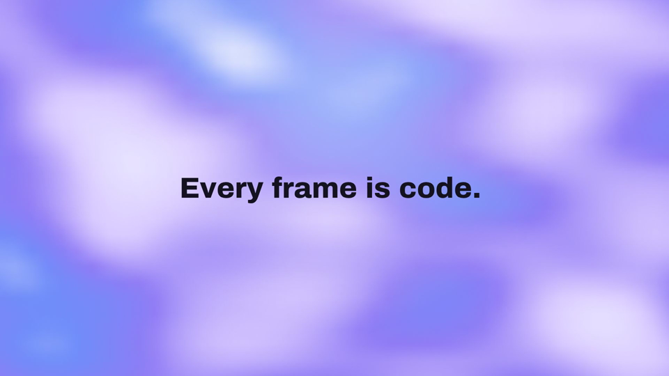
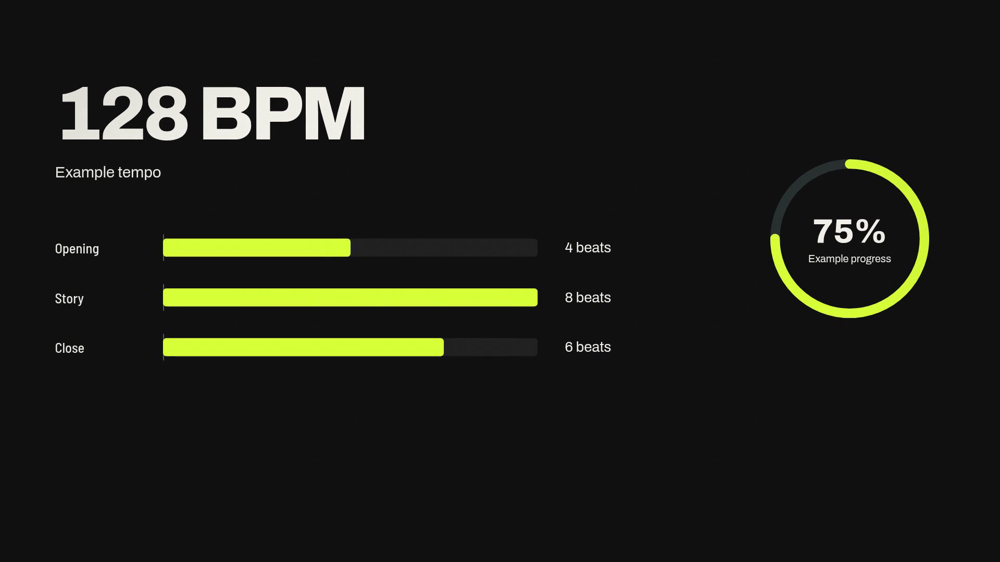

# demotion

Make product launch videos in code. Demotion is an MIT-licensed toolkit for timing React scenes to a beat, animating SVGs, and rendering motion graphics on your computer with Remotion.

[](https://github.com/SohailKhan0525/demotion/actions/workflows/ci.yml)

[](https://github.com/SohailKhan0525/demotion/releases/download/v0.5.0/demotion-showcase.mp4)

[Watch the full toolkit film](https://github.com/SohailKhan0525/demotion/releases/download/v0.5.0/demotion-showcase.mp4) · [Find the source for a scene](docs/showcase/README.md) · [Repository inventory](docs/showcase/inventory.md)

## Quick start

Find the film, chapter list and source guide from your terminal:

```sh
npx --yes @demotion/cli@0.5.0 showcase
```

**Make a title card.** Open the standalone HTML in your browser, change the title and tempo, then scrub the twelve beats. **Save frame** exports a PNG. In browsers with video export support, **Export clip** records the animation as a silent video at your chosen tempo. [Download the editable Canvas demo](https://github.com/SohailKhan0525/demotion/releases/download/v0.4.0/canvas-launch.html) · [Watch the 24-second editor walkthrough](https://github.com/SohailKhan0525/demotion/releases/download/v0.4.0/demotion-canvas-launch.mp4)

With Node.js 22.14+ and npm, you can also create a copy from the published package:

```bash
npx --yes @demotion/cli@0.5.0 demo
```

Open `canvas-launch.html` in your browser or text editor. To start a React video project with the published toolkit:

```bash
npx --yes @demotion/cli@0.5.0 init my-video
cd my-video
npm install
npm start
```

**To edit the full toolkit film in Studio**, install Node.js 22.14+, npm, FFmpeg and ffprobe. Prepare its clips and open Studio from the checkout:

```bash
git clone https://github.com/SohailKhan0525/demotion.git
cd demotion
npm ci
npm run studio:showcase
```

Select **Showcase** in Remotion Studio and drag the playhead to inspect a scene.
The [film guide](docs/showcase/README.md) identifies the original composition, example or component behind each shot. Node 22 and 24 are tested in CI. Setup requires network access for
dependencies and a Chromium download on first use. Fonts are bundled.

## Create a video project from this checkout

From the cloned `demotion` directory, build and pack the current source. Install
that tarball into the generated starter so your project uses this MIT revision.
The previously published npm package `@demotion/cli@0.3.0` carries its original license.

```bash
npm run build
TARBALL=$(npm pack --silent)
node bin/demotion.js init ../my-video
cd ../my-video
npm install "../demotion/$TARBALL"
npm start
```

The commands above use a POSIX shell. In PowerShell use `$TARBALL = npm pack --silent` for the pack step.

With Studio open, edit `src/MyVideo.tsx`. In a second terminal in `my-video`,
render the two-scene starter (150 frames at 30 fps, five seconds):

```bash
npm run render       # out/video.mp4 — 1920×1080
npm run render:4k    # out/video-4k.mp4 — 3840×2160
```

## Edit your video

This is the actual starter source in `src/MyVideo.tsx`:

<!-- starter-example -->
```tsx
import { Series } from "remotion";
import { TitleCard, highlight } from "@demotion/cli";

export const MyVideo = () => (
  <Series>
    <Series.Sequence durationInFrames={60}>
      <TitleCard text={[highlight("Hello, ", "#14121f"),
        highlight("demotion", "#a21caf")]} />
    </Series.Sequence>
    <Series.Sequence durationInFrames={90}>
      <TitleCard text="Every frame is code." />
    </Series.Sequence>
  </Series>
);
```
<!-- /starter-example -->



A frame rendered from the starter above.

Change the text and colors here. Change the composition settings in
`src/Root.tsx` for a different duration, frame rate or canvas size. Keep the scene
lengths and composition duration consistent. `ensureFontsLoaded()` is already
called by the starter, using files copied into `public/fonts`.

## The 0.3 illustration tools

[Watch the original 0.3 illustration film](https://github.com/SohailKhan0525/demotion/releases/download/update-030/demotion-update-030.mp4).

Reveal SVG strokes with `DrawPath`, move artwork along a curve with `FollowPath`,
or use `usePathMotion` to read its position and rotation. These APIs use the
containing `Shot`'s beat clock, so seeking to any frame gives the same result.
`WorkflowIllustration` combines the path tools into a reusable animated diagram.

For 3D, `Scene3D` provides a lit Three.js scene with camera poses timed in beats.
`ExtrudedSvg` turns filled SVG contours into beveled meshes with depth, materials
and optional staggered entrances. These exports live in `@demotion/cli/three`;
install the [optional 3D dependencies](#optional-3d) before using them.

[Build a complete 2D illustration](docs/illustration.md) ·
[Build a complete 3D illustration](docs/three-illustration.md)

The [starter instructions](#create-a-video-project-from-this-checkout) install these APIs from your checkout.

## Since 0.2.0: data stories and captions

Available since `@demotion/cli@0.2.0`: `CountUp`, `BarChart`,
`CaptionTrack`, `LowerThird` and `ProgressRing`. They share the scene engine's beat
clock and support deterministic seeking.
[Run the complete example and read the API guide](docs/components.md).

The 0.2.0 release also fixed project creation in directories containing spaces,
punctuation or Unicode, and added safely quoted terminal instructions.



A frame from the complete example; values are demonstration data.

The [second launch film](https://github.com/SohailKhan0525/demotion/releases/tag/launch-v2)
shows these components; “V2” is the film edition, not an npm 2.0 release.
The archived [Ideas deserve motion promo](docs/promo/README.md) gives each
demonstration more time and includes a [complete typography example](examples/promo-scene.tsx)
that works with the published package.

## Components and timing

For an existing Remotion project, install the release with `npm install @demotion/cli@0.5.0`, or install your local tarball to test changes.

Import from `@demotion/cli`:

| Export | Use |
| --- | --- |
| `TitleCard`, `highlight` | Starter titles and highlighted text |
| `createBeatClock`, `spring`, `outExpo` | Beat timing and easing |
| `MotionProject`, `Shot`, `useShot` | Scenes with camera motion, wipes, grain and render-time motion blur |
| `KineticHeadline`, `WideStack` | Animated letters and variable-width type |
| `Terminal`, `CodePanel` | Timed typing and source-code reveals |
| `DrawPath`, `FollowPath`, `usePathMotion` | SVG stroke reveals, path position and rotation |
| `WorkflowIllustration` | Animated source-to-composition diagram |

`Terminal` and `CodePanel` use the clock and theme of their containing `Shot`.
See [their props and examples](docs/ui.md). The toolkit also retains its earlier
UI components; their styling varies. The newer scene engine is the recommended
starting point for beat-driven work.

The starter pins all Remotion packages to `4.0.528`. Keep Remotion and its
`@remotion/*` packages on matching versions when extending the project.

## Generate a soundtrack

From the generated video project, save this as `cues.json`:

```json
{
  "bpm": 120,
  "beats": 8,
  "music": { "kick": [[0, 8]], "arp": [[0, 8]], "bass": [[0, 8]] },
  "cues": [
    { "at": 0, "kind": "hit" },
    { "at": 4, "kind": "whoosh" },
    { "at": 4, "kind": "hit" },
    { "at": 6, "kind": "chime" }
  ]
}
```

```bash
npx --no-install demotion audio cues.json out/soundtrack.wav
```

Times and durations in the cue file are beats. The generated WAV includes a
reverb tail. The engine targets −14 LUFS by default; measure the finished video
for delivery. To use the file, copy it into your project's `public` directory and
add Remotion's `<Audio src={staticFile("soundtrack.wav")} />` to your composition.
The audio API is also available from `@demotion/cli/audio`.

## Optional 3D

`Scene3D`, `ExtrudedSvg`, `Stack3D` and related exports live at
`@demotion/cli/three`. For the **React 18 /
Remotion 4.0.528 starter**, install the tested optional dependencies:

```bash
npm install three@0.160.1 postprocessing@6.36.4 @react-three/fiber@8.17.10 @react-three/postprocessing@2.16.3 @remotion/three@4.0.528
```

```tsx
import { Scene3D, ExtrudedSvg, Stack3D } from "@demotion/cli/three";
```

The [3D illustration guide](docs/three-illustration.md) includes a complete scene
and explains the supported SVG input. Expand strokes and text into filled paths
before extruding them.

The basic starter and 2D illustration APIs do not need these peers. Real depth of
field can be expensive on software graphics, so use a small test render before
rendering a long scene.

## Troubleshooting

- **Browser download unavailable:** install Chromium and pass
  `--browser-executable=/path/to/chromium` to the generated project's Remotion
  command, for example `npm run render -- --browser-executable=/usr/bin/chromium`.
- **Remotion version mismatch:** align `remotion` and all installed `@remotion/*`
  versions. Avoid forcing an incompatible dependency tree.
- **Slow rendering:** reduce Remotion's concurrency on a small machine, for example
  `npm run render -- --concurrency=2`. 4K and 3D need more time and memory.
- **Blank text or missing fonts:** keep `public/fonts` and the starter's font-loading
  call. The CLI copies the font license files with the fonts.

## License and contributions

Demotion-owned code and examples in this checkout use the [MIT License](LICENSE).
You can use them in personal projects, client work, and commercial products.
Include the copyright and license notice when distributing the software.
The bundled fonts use the SIL Open Font License. The React renderer uses
[Remotion 4 under its own terms](https://www.remotion.dev/docs/terms-4-0).
See [third-party notices](THIRD_PARTY_NOTICES.md) for details.

Pull requests, examples, and bug reports are welcome. If a preview differs from
your render, include the composition, frame number, and what you expected to see.
[Contributing guide](CONTRIBUTING.md) · [Report a problem](https://github.com/SohailKhan0525/demotion/issues/new/choose) · [Optional project donations](https://ko-fi.com/qofenoai)

## Development

Follow the [quick start](#quick-start) to open the repository in Studio.
Select **Showcase**, **UpdateFilm**, **PromoLaunch**, **LaunchV2**, **Launch**, **Lab**, or **UI**
in Studio. Generated media stays in ignored `out/`; the source remains available
to regenerate each film.

```bash
npm run lint
npm run build
npm test
```

Render and check the toolkit showcase with FFmpeg, ffprobe and Chromium installed:

```bash
npm run render:showcase
npm run check:showcase
```

[Launch a project on GitHub](docs/product-launch.md) · [Data film](docs/launch-v2/README.md) · [Ideas deserve motion](docs/promo/README.md) · [Illustration film](docs/update-film/README.md) · [Canvas film](docs/canvas-film/README.md)

See [development notes](docs/DEVELOPMENT.md) for source rendering and verification,
and [release instructions](docs/PUBLISHING.md) for publishing. npm releases are
public, use the organization package `@demotion/cli`, and have provenance disabled.
