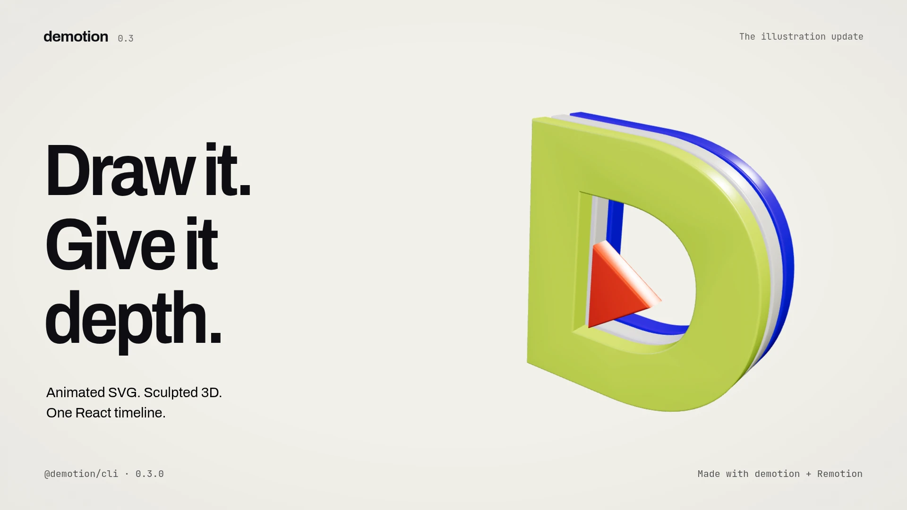
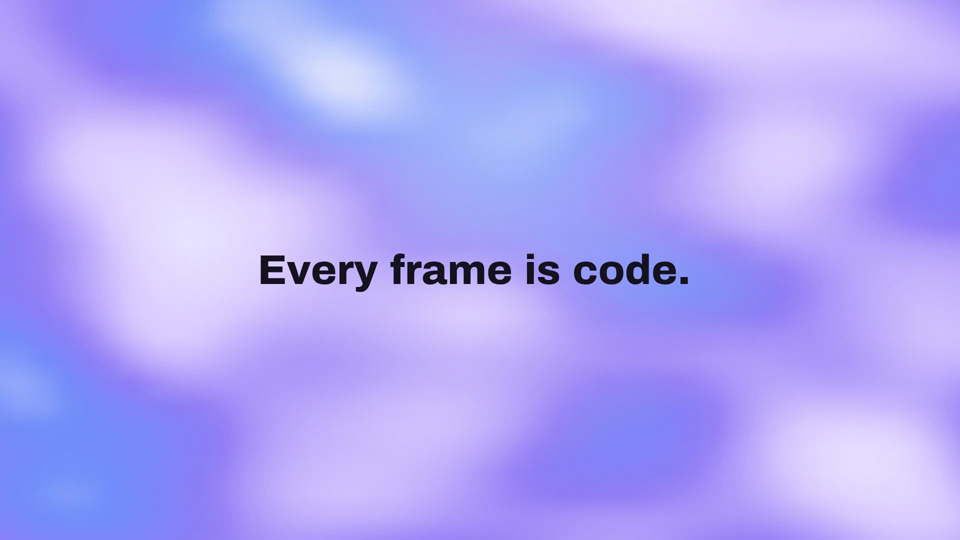
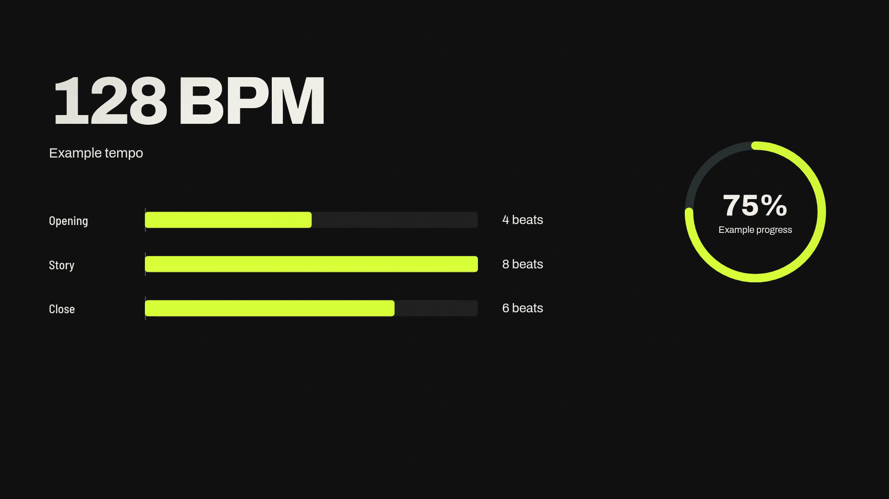

# demotion

**Motion graphics, written in code.** Create videos with React and render them on your own computer using [Remotion](https://www.remotion.dev).

[](https://github.com/SohailKhan0525/demotion/actions/workflows/ci.yml)
[Package](https://www.npmjs.com/package/@demotion/cli) · [Illustration guide](docs/illustration.md) · [Examples](#edit-your-video) · [UI reference](docs/ui.md) · [Issues](https://github.com/SohailKhan0525/demotion/issues)

`@demotion/cli` includes the `demotion` command, React components, beat-based timing,
animated SVG paths, procedural audio, bundled fonts, and optional 3D scenes.
Videos render locally; there is no hosted rendering service to configure.

[](https://github.com/SohailKhan0525/demotion/releases/download/update-030/demotion-update-030.mp4)

[Watch / download the 0.3 film](https://github.com/SohailKhan0525/demotion/releases/download/update-030/demotion-update-030.mp4)
· [Film source](src/update-film/UpdateFilm.tsx)

40 seconds of animated paths, original illustrations and real extruded SVG geometry,
with a procedural soundtrack. Made with the APIs in `@demotion/cli@0.3.0`.

## Quick start

Use **Node.js 22.14+** and npm. Node 22 and 24 are tested in CI. Rendering needs a
Chromium browser; Remotion can download a supported browser on first use. Package
installation and that browser download require Internet access. Fonts are bundled.

```bash
npx --yes @demotion/cli@latest init my-video
cd my-video
npm install
npm start
```

Remotion Studio opens a preview. Edit `src/MyVideo.tsx`. Open a second terminal
in `my-video` (or stop Studio with Ctrl+C), then render:

```bash
npm run render       # out/video.mp4 — 1920×1080
npm run render:4k    # out/video-4k.mp4 — 3840×2160
```

The starter contains two scenes totaling **150 frames at 30 fps: five seconds**.
These are starter settings, not a limit on your own video's duration.

## Edit your video

This is the actual starter source in `src/MyVideo.tsx`:

<!-- starter-example -->
```tsx
import { Series } from "remotion";
import { TitleCard, highlight } from "@demotion/cli";

export const MyVideo = () => (
  <Series>
    <Series.Sequence durationInFrames={60}>
      <TitleCard text={[highlight("Hello, ", "#14121f"),
        highlight("demotion", "#a21caf")]} />
    </Series.Sequence>
    <Series.Sequence durationInFrames={90}>
      <TitleCard text="Every frame is code." />
    </Series.Sequence>
  </Series>
);
```
<!-- /starter-example -->



A frame rendered from the starter above.

Change the text and colors here. Change the composition settings in
`src/Root.tsx` for a different duration, frame rate or canvas size. Keep the scene
lengths and composition duration consistent. `ensureFontsLoaded()` is already
called by the starter, using files copied into `public/fonts`.

## New in 0.3.0: draw it, give it depth

Reveal SVG strokes with `DrawPath`, move artwork along a curve with `FollowPath`,
or use `usePathMotion` to read its position and rotation. These APIs use the
containing `Shot`'s beat clock, so seeking to any frame gives the same result.
`WorkflowIllustration` combines the path tools into a reusable animated diagram.

For 3D, `Scene3D` provides a lit Three.js scene with camera poses timed in beats.
`ExtrudedSvg` turns filled SVG contours into beveled meshes with depth, materials
and optional staggered entrances. These exports live in `@demotion/cli/three`;
install the [optional 3D dependencies](#optional-3d) before using them.

[Build a complete 2D illustration](docs/illustration.md) ·
[Build a complete 3D illustration](docs/three-illustration.md)

Upgrade an existing project with `npm install @demotion/cli@latest`, or use the
quick start above for a new project.

## Since 0.2.0: data stories and captions

Available since `@demotion/cli@0.2.0`: `CountUp`, `BarChart`,
`CaptionTrack`, `LowerThird` and `ProgressRing`. They share the scene engine's beat
clock and support deterministic seeking.
[Run the complete example and read the API guide](docs/components.md).

The 0.2.0 release also fixed project creation in directories containing spaces,
punctuation or Unicode, and added safely quoted terminal instructions.



A frame from the complete example; values are demonstration data.

The [second launch film](https://github.com/SohailKhan0525/demotion/releases/tag/launch-v2)
shows these components; “V2” is the film edition, not an npm 2.0 release.
The archived [Ideas deserve motion promo](docs/promo/README.md) gives each
demonstration more time and includes a [complete typography example](examples/promo-scene.tsx)
that works with the published package.

## Components and timing

For an existing Remotion project:

```bash
npm install @demotion/cli
```

Import from `@demotion/cli`:

| Export | Use |
| --- | --- |
| `TitleCard`, `highlight` | Starter titles and highlighted text |
| `createBeatClock`, `spring`, `outExpo` | Beat timing and easing |
| `MotionProject`, `Shot`, `useShot` | Scenes with camera motion, wipes, grain and render-time motion blur |
| `KineticHeadline`, `WideStack` | Animated letters and variable-width type |
| `Terminal`, `CodePanel` | Timed typing and source-code reveals |
| `DrawPath`, `FollowPath`, `usePathMotion` | SVG stroke reveals, path position and rotation |
| `WorkflowIllustration` | Animated source-to-composition diagram |

`Terminal` and `CodePanel` use the clock and theme of their containing `Shot`.
See [their props and examples](docs/ui.md). The toolkit also retains its earlier
UI components; their styling varies. The newer scene engine is the recommended
starting point for beat-driven work.

The starter pins all Remotion packages to `4.0.528`. Keep Remotion and its
`@remotion/*` packages on matching versions when extending the project.

## Generate a soundtrack

Save this as `cues.json`:

```json
{
  "bpm": 120,
  "beats": 8,
  "music": { "kick": [[0, 8]], "arp": [[0, 8]], "bass": [[0, 8]] },
  "cues": [
    { "at": 0, "kind": "hit" },
    { "at": 4, "kind": "whoosh" },
    { "at": 4, "kind": "hit" },
    { "at": 6, "kind": "chime" }
  ]
}
```

```bash
npx @demotion/cli audio cues.json out/soundtrack.wav
```

Times and durations in the cue file are beats. The generated WAV includes a
reverb tail. The engine targets −14 LUFS by default; measure the finished video
for delivery. To use the file, copy it into your project's `public` directory and
add Remotion's `<Audio src={staticFile("soundtrack.wav")} />` to your composition.
The audio API is also available from `@demotion/cli/audio`.

## Optional 3D

`Scene3D`, `ExtrudedSvg`, `Stack3D` and related exports live at
`@demotion/cli/three`. For the **React 18 /
Remotion 4.0.528 starter**, install the tested optional dependencies:

```bash
npm install three@0.160.1 postprocessing@6.36.4 @react-three/fiber@8.17.10 @react-three/postprocessing@2.16.3 @remotion/three@4.0.528
```

```tsx
import { Scene3D, ExtrudedSvg, Stack3D } from "@demotion/cli/three";
```

The [3D illustration guide](docs/three-illustration.md) includes a complete scene
and explains the supported SVG input. Expand strokes and text into filled paths
before extruding them.

The basic starter and 2D illustration APIs do not need these peers. Real depth of
field can be expensive on software graphics, so use a small test render before
rendering a long scene.

## Troubleshooting

- **Browser download unavailable:** install Chromium and pass
  `--browser-executable=/path/to/chromium` to the generated project's Remotion
  command, for example `npm run render -- --browser-executable=/usr/bin/chromium`.
- **Remotion version mismatch:** align `remotion` and all installed `@remotion/*`
  versions. Avoid forcing an incompatible dependency tree.
- **Slow rendering:** reduce Remotion's concurrency on a small machine, for example
  `npm run render -- --concurrency=2`. 4K and 3D need more time and memory.
- **Blank text or missing fonts:** keep `public/fonts` and the starter's font-loading
  call. The CLI copies the font license files with the fonts.

## License — free for personal use, paid for business

Demotion uses the [PolyForm Noncommercial License 1.0.0](./LICENSE). It is **source-available**, not OSI "open source".

| You are… | License |
|---|---|
| An individual: personal projects, hobby, research, study | **Free** |
| A school, charity, public-research or government body | **Free** |
| A freelancer, a team, or a company — any paid, client or product-promoting work | **[Commercial license](./COMMERCIAL-LICENSE.md)** — Solo / Team / Company |

Get a commercial license or support the project on Ko-fi: **https://ko-fi.com/qofenoai**

Demotion is built on Remotion, which has its **own** license (it may require a company license for larger teams): https://www.remotion.dev/docs/terms

## Support the project

Demotion is built and maintained by one person. If it saves you time, please support it: **https://ko-fi.com/qofenoai** ☕

## Contributing

Bug reports and ideas are very welcome in [Issues](https://github.com/SohailKhan0525/demotion/issues). I'm not accepting code pull requests yet, because contributions to a dual-licensed project need a contributor agreement that isn't set up.

## Development

```bash
git clone https://github.com/SohailKhan0525/demotion.git
cd demotion
npm ci
npm run dev
```

Select **UpdateFilm**, **PromoLaunch**, **LaunchV2**, **Launch**, **Lab**, or **UI**
in Studio. Generated media stays in ignored `out/`; the source remains available
to regenerate each film.

```bash
npm run lint
npm run build
npm test
```

Generate the 0.3 update film and its visual checks:

```bash
npm run qa:update      # out/update-film/contact-sheet.jpg + stills
npm run render:update  # out/update-film/demotion-update-030.mp4
npm run check:update   # verify codecs, dimensions, frames and duration
```

The earlier films remain reproducible: [second launch film](docs/launch-v2/README.md)
and [Ideas deserve motion](docs/promo/README.md).

See [development notes](docs/DEVELOPMENT.md) for source rendering and verification,
and [release instructions](docs/PUBLISHING.md) for publishing. npm releases are
public, use the organization package `@demotion/cli`, and have provenance disabled.
