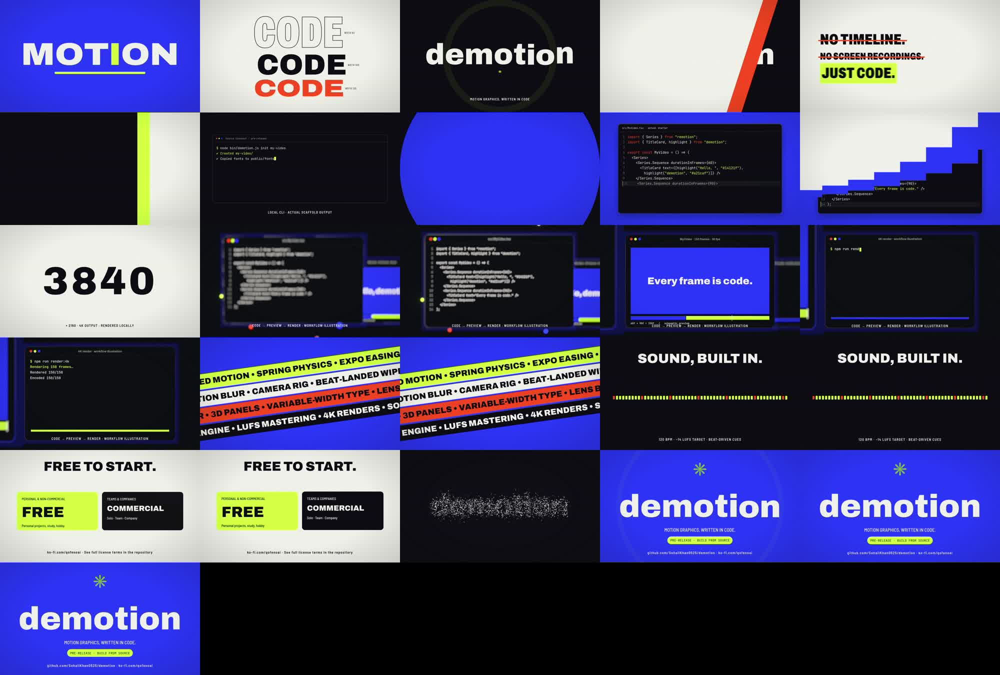
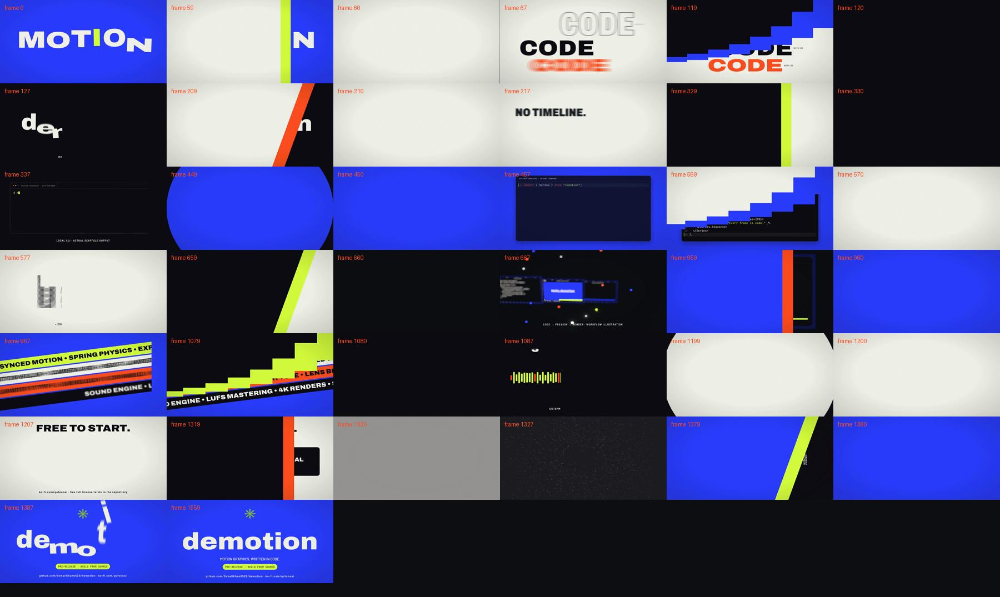

# Launch film: implementation and QA

The original 13-shot launch is 52 beats at 120 BPM: 1560 frames, 26 seconds,
1920×1080 at 60 fps. `src/launch/timeline.ts` drives both shot durations and audio
cues. `Launch` replaces the rejected reference-copy composition; Lab and UI remain
available. The old, unexported DemoReel implementation was removed.

## Content and visual decisions

- The starter source is tokenized without changing its text. Tests compare every
  byte against `template/src/MyVideo.tsx` (14 lines).
- The CLI command uses `node bin/demotion.js init my-video`, because the project is
  pre-release. Tests run the real CLI and check the displayed output. The final
  card says “PRE-RELEASE · BUILD FROM SOURCE”, not an unverified registry install.
- The 3D workflow is explicitly labeled an illustration. Its preview represents
  the starter's actual 60+90-frame, 30fps structure. Progress labels are illustrative,
  not a recording of a real render's elapsed time.
- The stack camera visits the three panels, using expo movement and a temporary
  focus dip. Depth of field uses the actual depth buffer. Stack uses one temporal
  sample; the lighter shots use six samples. Camera punch and grain remain enabled.
- Five theme colors and bundled fonts are used in the launch. Canvas panel colors
  and ParticleText's previous Inter mask were updated. ParticleText now waits for
  the fonts before sampling its mask; reverse-seek behavior is frame-driven.

## Checks performed

- TypeScript lint, ESM/type build, 29 tests pass. Tests include shared cut/cue times,
  exact starter content, real CLI output, Unicode typing, seeking and wipe deadlines.
- A delayed-layer defect in Wipe was fixed: every layer covers the screen on the
  cut frame and clears by the end of the transition. Fractional delay arithmetic
  has explicit endpoint handling.
- The generated WAV is 28 seconds including reverb tail. FFmpeg `ebur128=peak=true`
  measured −14.1 LUFS integrated and −2.7 dBTP. The picture is 26 seconds; its
  Audio component applies a 1.4-second fade before the picture endpoint. Measure
  the encoded deliverable separately; WAV measurements are not MP4 measurements.
- A local `npm pack` tarball was installed into a fresh scaffold. Chromium rendered
  frame 100 of MyVideo at 3840×2160. This verifies local packaging and a 4K frame,
  not registry publication or a full 4K movie. The existing starter still uses
  legacy TitleCard styling; modernizing that default is a follow-up.
- `examples/cues.json` generated a valid 5.5-second WAV at −13.9 LUFS according to
  the built-in meter. The README describes this tested path.

## Visual passes

First pass: `out/launch-qa/overview-pass1.jpg`. Reviewed all 13 shots and opening,
cut, transition, settle and final frames. Opening is composed and the final card
holds. Dark/light/color backgrounds alternate. Noted small code and terminal
text, overly heavy grain/vignette, and the need to protect the soundtrack ending.

Second pass: `out/launch-qa/detail-pass2.jpg`. Increased terminal text from 27 to
30px and code text from 28 to 32px; added syntax token colors, reduced grain to
0.06 and vignette to 0.17, and added the picture-end audio fade. Inspected stack
preview, progress and completion frames: font rendering and depth separation work.
The dense terminal output remains supporting detail; the command is the focal line.
The audio bars are labeled beat-driven, not presented as measured sound analysis.

The cloud instance has four CPU cores. Forcing `--gl=swangle` made the full render
very slow. A ten-frame benchmark at frames 70–79 completed using the browser's
default backend with concurrency 2, and a separate 3D still also succeeded with
that backend. The full render uses that tested configuration with CRF 18,
H.264, BT.709 tagging and 192 kbit/s AAC. Render logs are kept under ignored `out/`.

## Remaining scope

The audit is a heuristic, not a quality certificate. `audit-baseline.md` preserves
the original scan; `audit.md` is the updated scan. Many flagged interpolations
already map a spring value into a range (CardFan, FloatingCard, CodeTabs); adding
another ease would distort the spring. Black/white SVG masks and font fallback
lists are also legitimate hits. Other legacy public components still have older
palettes, small default type and hardcoded frame intervals. They are kept for
compatibility and have not been silently described as upgraded. A deliberate
legacy component pass remains under handoff T6. License and release decisions
remain with the owner. No npm publication is part of this work.

## Dependency repeatability

A final unrestricted-range install exposed a real compatibility issue: caret
ranges advanced some development `@remotion/*` packages to 4.0.539 while the CLI
and core stayed at 4.0.528. The UI test caught the mixed-version runtime. All
Remotion development packages are now pinned to 4.0.528, matching the lockfile's
existing resolved versions. Consumer peer ranges remain compatible with v4.
CI and release validation use `npm ci`. Restore the locked dependencies before
running final checks; do not treat the failed mixed-version test as passing.

## Final encoded delivery

`out/demotion-launch.mp4` is the delivered 26-second file: 1560 frames,
1920×1080/60fps, H.264/yuv420p, BT.709, AAC. The opening and ending frames are
nonblank. Studio startup and HTML delivery also passed after the lockfile restore.
All development Remotion packages resolve to 4.0.528, and the final lint, build and
29 tests pass with no skipped tests.

The first encoded audio stream was delayed by 2048 samples (42.67ms), even though
planned cue times were exact. `scripts/finalize-launch-audio.mjs` fixes delivery by
encoding directly from the original WAV, trimming to 26s and applying the 1.4s
fade, while copying the video stream. `postrender` and `postrender:4k` run it
automatically. It requires FFmpeg/ffprobe and rejects partial-length input.
For chunk rendering, invoke Remotion directly and assemble the full picture first.

After this correction, an FFT cross-correlation over the first four seconds
(source WAV versus decoded delivered AAC, ±200ms search) measured **0 samples /
0ms / 0 frames** of offset, with normalized correlation **0.9965**. This measures
transport alignment; cue generation itself remains covered by the audio tests.
FFmpeg measured the final MP4 at **−14.1 LUFS integrated, −2.4 dBTP**. A second
finalization run preserved the video-packet SHA-256 exactly, confirming idempotent
picture copying without another picture encode.

The encoded overview and the frames immediately before, on and after every cut
were opened and inspected. Wipes cover their cut frames; mid-transition layers,
letter motion blur, stack depth, particle formation and the final hold are visible.
These stills do not establish a complete subjective audio/playback review.

Machine-readable checks and measurement logs remain in ignored `out/`:
`launch-media-check.json`, `launch-audio-alignment.json`,
`launch-encoded-audio-meter.log`, `final-tests.log`, and `final-studio.log`.
The soundtrack waveform/spectrogram with beat lines is
`out/launch-audio-analysis.png`. The full 4K launch movie was not rendered;
only a 4K starter still was validated. At initial validation, no remote push, npm release or license
change had been performed. The subsequent repository upload includes the MP4 at
`media/demotion-launch.mp4`; npm publication remains a separate manual decision.
